# 💰 BudgetWise

[](https://github.com/nickolaimakaronok/budgetwise/actions/workflows/tests.yml)


A personal finance desktop app written in Python. Track income and expenses, set monthly budgets, plan savings goals and see where the money goes.
Everything stays on your computer in a local SQLite database.

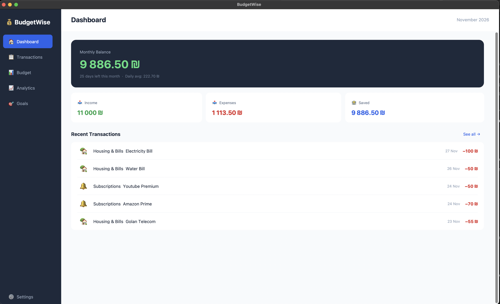

▶️ [Demo video](https://youtu.be/-BR_jM5aqeQ) (recorded with v1.x)

---

## Download

**[⬇️ BudgetWise 2.1 — latest release](https://github.com/nickolaimakaronok/budgetwise/releases/latest)** — no Python needed.

| Computer | File |
|---|---|
| Mac with Apple Silicon (M-series) | `BudgetWise-macOS-AppleSilicon.zip` |
| Mac with Intel | `BudgetWise-macOS-Intel.zip` |
| Windows 10 / 11 | `BudgetWise-Windows.zip` |

The apps are not signed with a paid Apple / Microsoft certificate, so the system asks once on the first start:

- **macOS** — unzip and open `BudgetWise.app`. If macOS says it can't verify the app, click **Done**, then go to **System Settings → Privacy & Security** and click **Open Anyway**.
- **Windows** — right-click the zip → **Extract All**, open the `BudgetWise` folder and run `BudgetWise.exe`. If SmartScreen appears, click **More info → Run anyway**.

---

## Features

- **Dashboard** — monthly balance, income, expenses and savings, latest transactions
- **Transactions** — add, edit, delete; filter by type, category, dates and #tags; search by note, category or tag; quick add with ⌘N / Ctrl+N
- **Multiple currencies** — add a purchase in euros, dollars or any other currency: it is converted at the rate of that day and the list shows both amounts; changing a rate later never changes past purchases; the main currency can be changed later — only the symbol, or converting everything with one rate
- **Recurring payments** — rent, subscriptions and salary are added every month automatically; missed months are caught up and the day never drifts (31 Jan → 28 Feb → 31 Mar)
- **Bank CSV import** — choose the columns, date format and how the amount sign is read; the file encoding is detected automatically (UTF-8, UTF-16, Windows-1251 Cyrillic, Windows-1255 Hebrew); a statement in another currency is converted at the rate you enter
- **Export** — CSV that opens correctly in Excel and can be imported back (with the original amount, currency and rate), plus a monthly PDF report
- **Budgets** — monthly limit per category, warning at 80 % and alert at 100 %, copy last month's limits in one click, system notifications when a limit is exceeded
- **Analytics** — spending by category and by day, income vs. expenses over the year, best and worst month, month-by-month comparison
- **Goals** — savings goals with contributions, deadlines and how much to save per month
- **Settings** — main currency (₪ $ € £ ₽ Br), exchange rates, light / dark / system theme, English / Russian / German, custom categories, one-click backup

<table>
  <tr>
    <td colspan="2">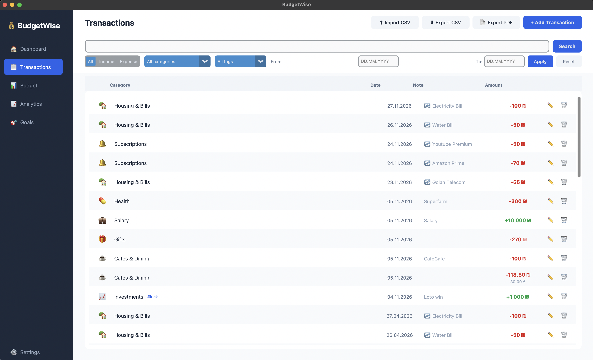<br><sub>Transactions — search, filters, recurring payments 🔄 and a purchase in euros</sub></td>
  </tr>
  <tr>
    <td width="50%">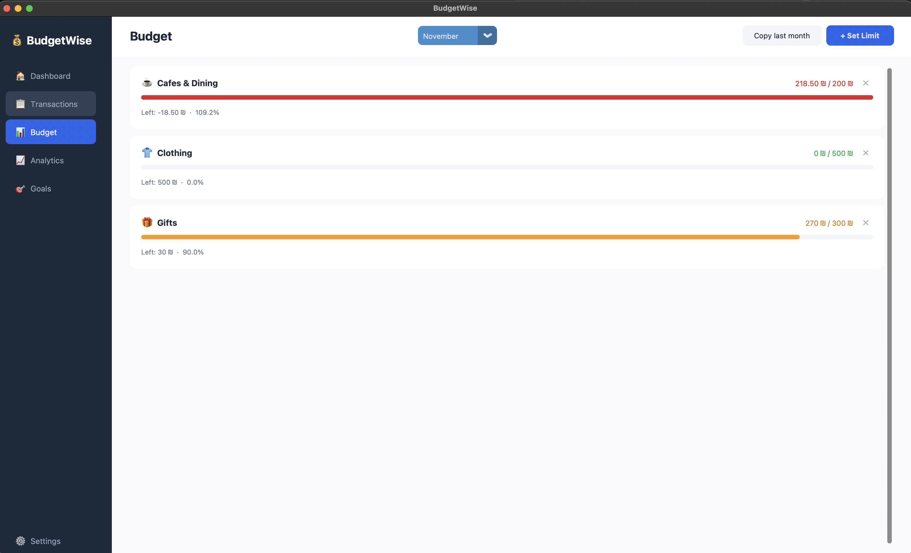<br><sub>Budget limits — over, close to and under the limit</sub></td>
    <td width="50%">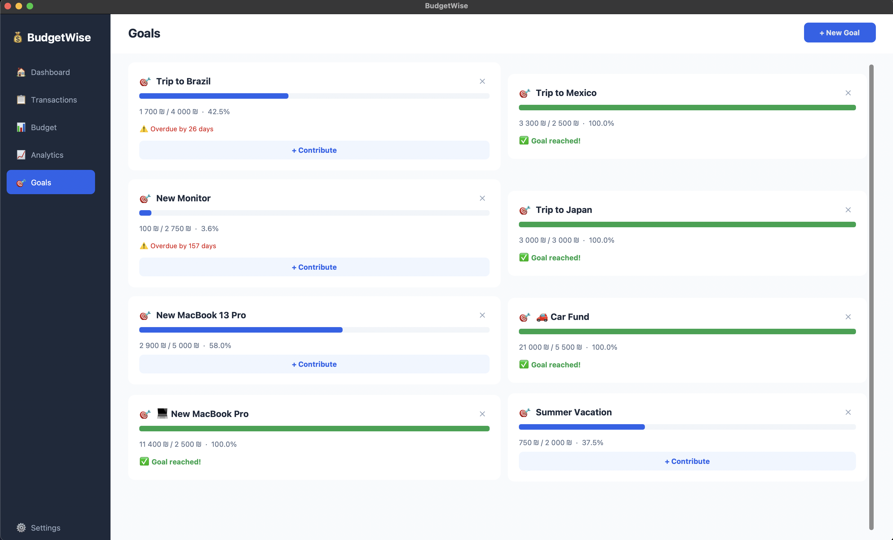<br><sub>Savings goals with deadlines</sub></td>
  </tr>
  <tr>
    <td>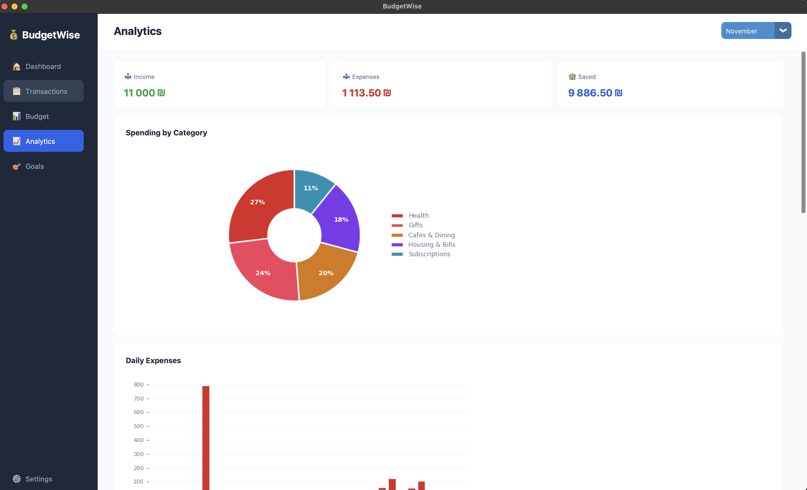<br><sub>Analytics — spending by category</sub></td>
    <td>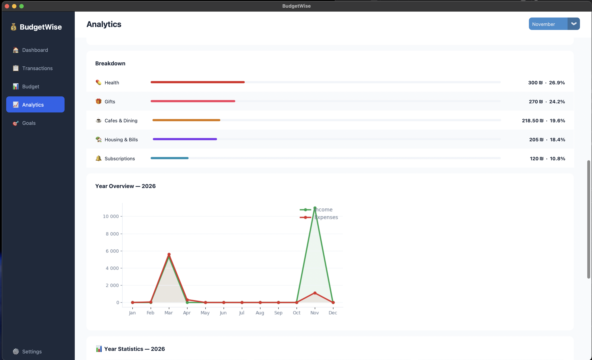<br><sub>Analytics — breakdown and the year overview</sub></td>
  </tr>
  <tr>
    <td>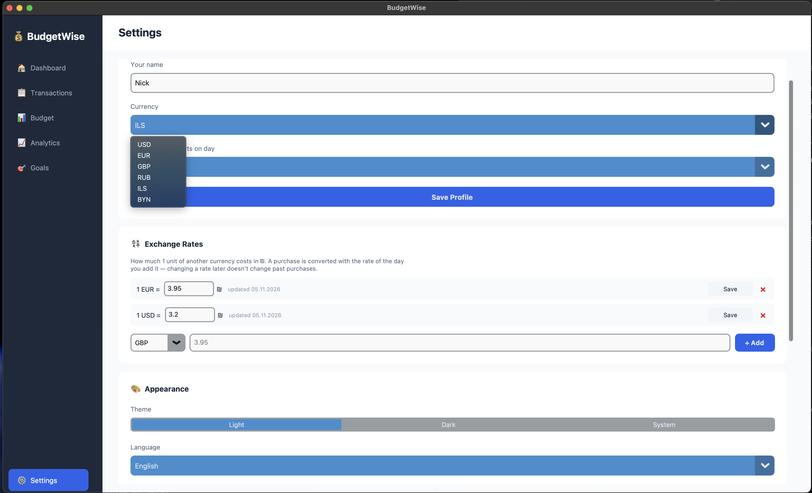<br><sub>Settings — main currency and exchange rates</sub></td>
    <td>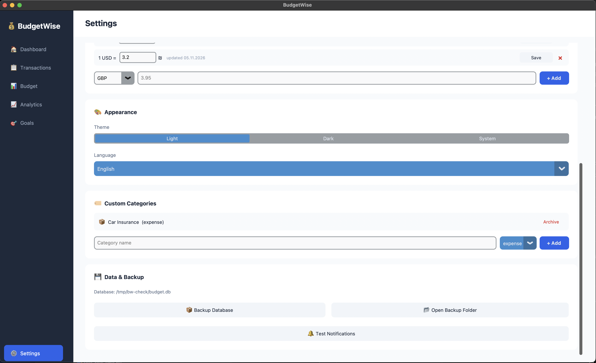<br><sub>Settings — theme, language, categories and backups</sub></td>
  </tr>
</table>

**Multiple currencies**

<table>
  <tr>
    <td align="center">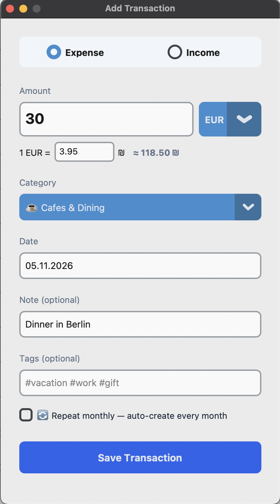<br><sub>A purchase in euros, converted at the day's rate</sub></td>
    <td align="center">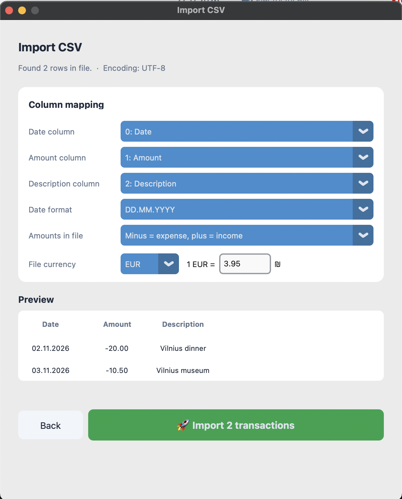<br><sub>Importing a bank statement in euros</sub></td>
    <td align="center">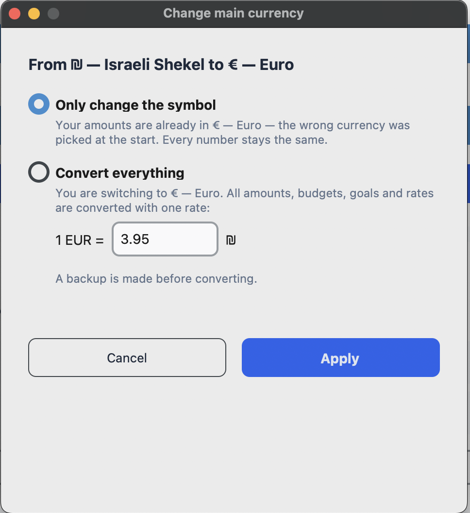<br><sub>Changing the main currency</sub></td>
  </tr>
</table>

---

## Under the hood

- **Layered architecture.** `ui/` only displays data, `services/` holds all business logic, `models/` defines the Peewee ORM models. The UI never queries the database directly, so the logic is tested without opening a window.
- **Money is stored as integer cents.** No floating-point rounding anywhere, including CSV import and export.
- **Currencies without rounding drift.** A purchase is converted once, when it is saved, with `Decimal` and the rate of that day; the original amount, currency and rate stay on the transaction, like on a bank statement. Changing the main currency converts transactions, budgets, goals and saved rates in one database transaction (all or nothing) after a backup, and purchases made in the new currency get back their exact original amount, so switching back is exact.
- **Data safety**
  - Automatic backup on every start using the SQLite backup API (it includes data still in the WAL file); the newest 10 are kept, manual backups are never deleted.
  - Versioned schema migrations (`PRAGMA user_version`) upgrade old databases in place. A regression test covers a real bug where adding a column after `create_tables()` corrupted the database file.
  - On upgrade, user data is moved from `~/Documents` to the OS app-data folder with a one-time migration: copy → integrity check → row-count check → atomic rename. The old file is kept, nothing is deleted.
- **Recurring transactions as a series.** One template, generated copies and a "last generated month" counter: running it twice creates nothing new, missed months are caught up, and editing or deleting a copy never causes a double charge.
- **Cross-platform.** Everything OS-specific lives in `utils/platform_utils.py`: the data folder, keyboard shortcuts, opening folders, and notifications (`osascript` on macOS, `plyer` on Windows and Linux).
- **Performance.** Transactions render in pages of 200 rows, totals are calculated with SQL `SUM … GROUP BY`, and tags load in one query instead of one per row.
- **Tests and CI.** 320+ pytest tests, including an end-to-end test that clicks through the real windows: onboarding, transactions in two currencies, import and export, budgets, goals, settings and changing the main currency. GitHub Actions runs them on macOS, Windows and Linux with Python 3.12, 3.13 and 3.14 on every push. Tests use in-memory or temporary databases and never touch real user data.
- **Release pipeline.** A version tag builds the app for macOS (Apple Silicon and Intel) and Windows, then runs each packaged app in a self-check mode that opens every page and builds a PDF report; the release is published only if all of them pass. This caught a crash that existed only in the packaged app — a Pillow module PyInstaller hadn't bundled.

---

## Run from source

Requires **Python 3.12 – 3.14** with Tk (included in the python.org installers; with Homebrew install `python-tk`, on Linux `python3-tk`).

**macOS / Linux**

```bash
git clone https://github.com/nickolaimakaronok/budgetwise.git
cd budgetwise
python3 -m venv .venv
source .venv/bin/activate
python -m pip install -r requirements.txt
python main.py
```

**Windows (PowerShell)**

```powershell
git clone https://github.com/nickolaimakaronok/budgetwise.git
cd budgetwise
py -m venv .venv
.venv\Scripts\Activate.ps1
python -m pip install -r requirements.txt
python main.py
```

On the first start a short onboarding asks for your name, currency and language, and 18 default categories are created.

> On Linux, desktop notifications need `notify-send` (package `libnotify-bin`).

### Run the tests

```bash
python -m pytest tests/ -q
```

Use `python -m pytest` rather than plain `pytest`, so the tests run with the Python from `.venv`.

### Build the app yourself

```bash
python -m PyInstaller --noconfirm --clean BudgetWise.spec
```

The result is `dist/BudgetWise.app` on macOS and `dist/BudgetWise/BudgetWise.exe` on Windows.

---

## Where your data lives

| OS | Folder |
|---|---|
| macOS | `~/Library/Application Support/BudgetWise/` |
| Windows | `%LOCALAPPDATA%\BudgetWise\` |
| Linux | `~/.local/share/BudgetWise/` |

The folder contains `budget.db`, the `backups/` folder and `budgetwise.log`. The exact path is shown in **Settings**, and **Open Backup Folder** opens the backups inside it.
To keep the data somewhere else, set the `BUDGETWISE_DATA_DIR` environment variable.

> **Upgrading from 1.x (running from source):** data in `~/Documents/BudgetWise` is moved automatically on the first start. The old database stays there as `budget.db.moved`.

---

## Project structure

```
budgetwise/
├── main.py                     # entry point: logging → migrations → onboarding → main window
├── requirements.txt
├── BudgetWise.spec             # PyInstaller build: macOS .app, Windows .exe
├── .github/workflows/          # tests.yml (tests on every push), build.yml (release builds)
├── db/
│   ├── database.py             # SQLite connection (Peewee) in the app-data folder
│   ├── migrations.py           # tables, schema upgrades, default categories
│   ├── backup.py               # backups via the SQLite backup API + rotation
│   └── data_move.py            # one-time move of the data out of ~/Documents
├── models/
│   └── models.py               # User, Category, Transaction, Budget, Goal, Tag
├── services/                   # business logic — the UI never touches the database
│   ├── transaction_service.py  # CRUD, filters, totals, recurring series
│   ├── budget_service.py       # limits, status, copy from last month
│   ├── analytics_service.py    # totals by category, day and year
│   ├── goal_service.py         # goals, contributions, deadlines
│   ├── tag_service.py          # #tags
│   ├── csv_import_service.py   # bank CSV: encodings, delimiters, amount formats
│   ├── csv_export_service.py
│   └── pdf_service.py          # monthly PDF report
├── ui/
│   ├── app.py                  # main window, sidebar, keyboard shortcuts
│   └── pages/                  # dashboard, transactions, budget, analytics, goals, settings, onboarding
├── utils/
│   ├── platform_utils.py       # everything that differs between macOS, Windows and Linux
│   ├── notifications.py        # background budget checks
│   ├── i18n.py                 # English / Russian / German texts
│   ├── formatters.py           # money and date formatting and parsing
│   ├── smoke_test.py           # self-check of the packaged app, run by build.yml
│   └── ...                     # theme, constants, logging, category translations
└── tests/                      # pytest suite; conftest.py points the app at a temporary folder
```

---

## Tech stack

| Layer | Technology |
|---|---|
| UI | CustomTkinter |
| Charts | Matplotlib (embedded in Tk) |
| Database | SQLite + Peewee ORM |
| PDF | ReportLab |
| Notifications | `osascript` on macOS, plyer on Windows / Linux |
| Tests and CI | pytest, GitHub Actions |
| Packaging | PyInstaller |

---

## Roadmap

- [ ] Layout polish for high-DPI Windows screens
- [ ] Stricter amount validation in forms
- [ ] Translated notification texts and PDF fonts for Cyrillic and Hebrew
- [ ] Hebrew interface (right-to-left)

---

## Changelog

### 2.1.0 — November 2026
- Purchases in other currencies: currency picker, exchange rate with a live preview and a hint when the rate is old, both amounts shown in the list
- Exchange rates in Settings: add, update, delete, with the date of the last update
- Changing the main currency: only the symbol, or convert all amounts, budgets, goals and rates with one rate (backup first, all or nothing)
- Recurring payments in another currency use the current rate; CSV export keeps the original amount, currency and rate; CSV import of a statement in another currency
- Belarusian ruble (Br); one shared currency list for onboarding, Settings and import
- Fixes: crash on an infinite or zero amount; the note is saved again when a transaction is edited
- End-to-end test through the real windows; 320+ tests

### 2.0.0 — November 2026
- Downloadable apps for macOS (Apple Silicon and Intel) and Windows, built and self-checked by GitHub Actions
- Cross-platform: Ctrl+N on Windows and Linux, opening folders and system notifications on every OS
- Data moved to the OS app-data folder with a safe automatic migration; a clear error window if the data can't be opened
- Reliable backups through the SQLite backup API, with rotation
- Recurring transactions rebuilt as series: no day drift, no double charges, missed months caught up
- All transactions are listed (in pages), not only the latest 200; faster totals and tag loading
- Bank CSV import with column mapping, sign modes and encoding detection (incl. Hebrew); CSV export with signed amounts and a UTF-8 BOM for Excel
- Python 3.12 – 3.14 and Tk 9 support; CI on macOS, Windows and Linux; 260+ tests

### Earlier versions
- **1.8.0** — first-start onboarding: name, currency, language
- **1.7.0** — English, Russian and German interface; system categories translated
- **1.6.0** — dark theme, monthly PDF report, yearly income vs. expenses chart
- **1.5.0** — search by category and note, goal deadlines
- **1.4.0** — recurring monthly transactions, database migrations for existing users
- **1.3.0** — goal service, logging to a file, GitHub Actions CI
- **1.2.0** — background budget notifications
- **1.1.0** — editing transactions, filters, CSV export, month selectors
- **1.0.0** — dashboard, transactions, budgets, analytics, goals, settings

---

Made by Nickolai Makaronok [nickolaimakaronok](https://github.com/nickolaimakaronok), Computer Science student at Tel Aviv University.